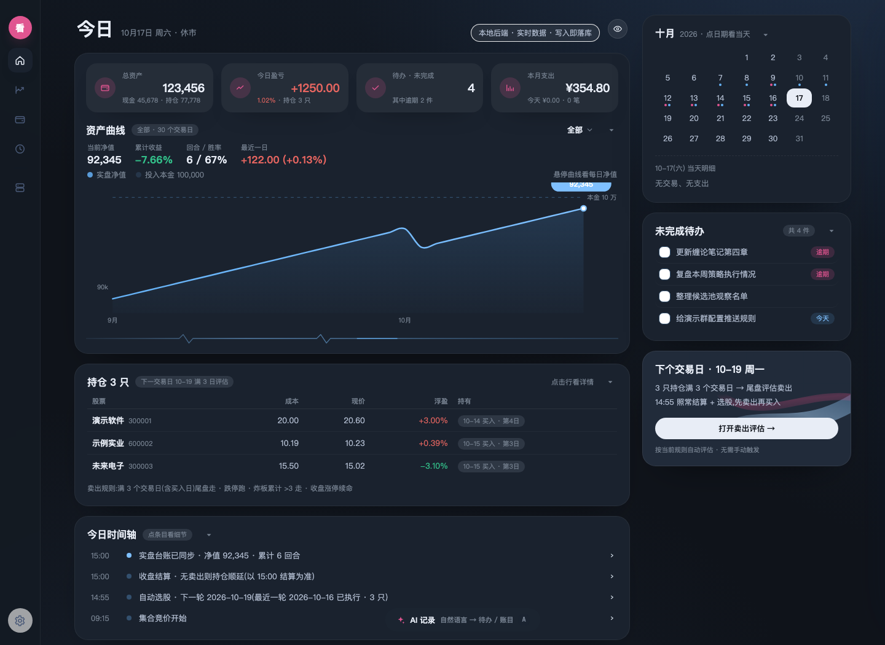
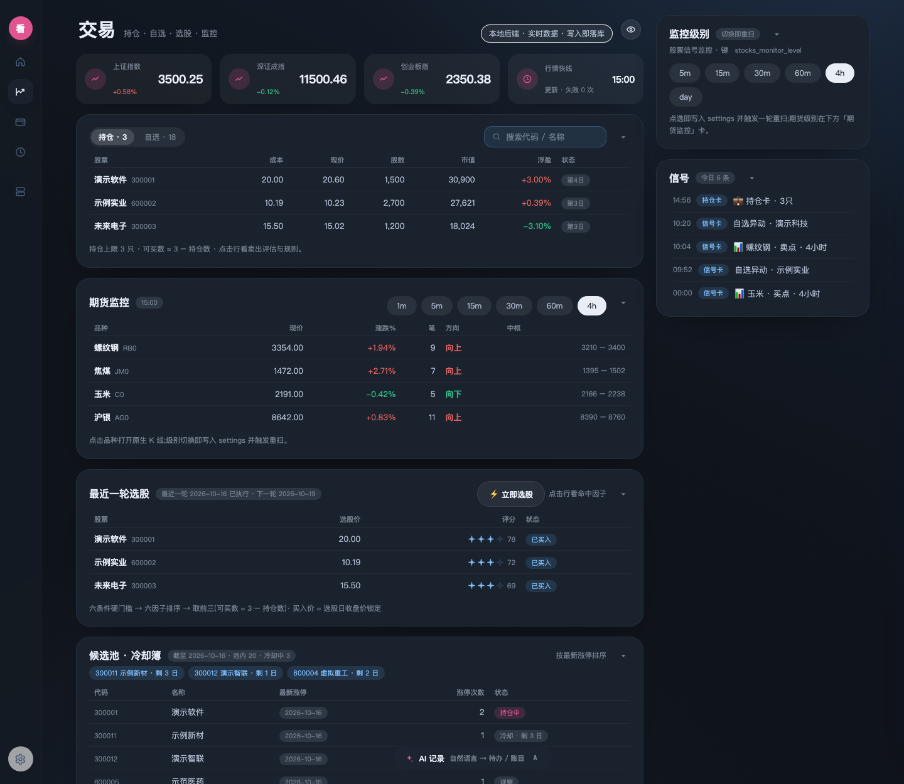
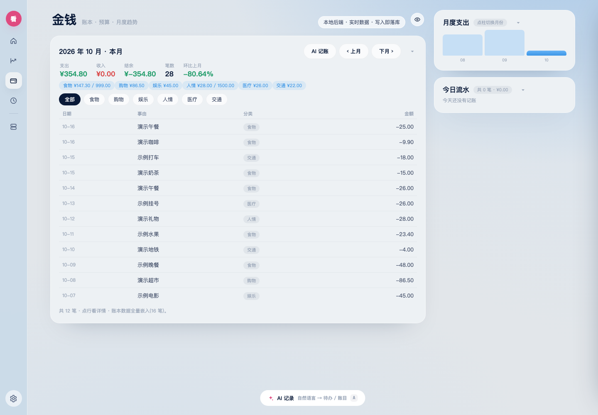
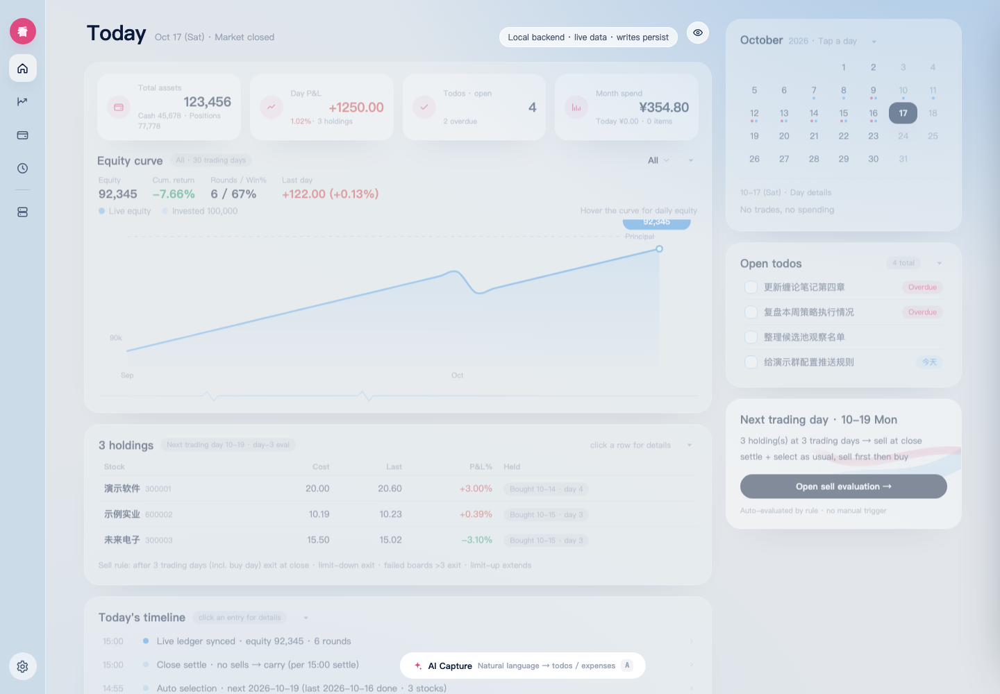
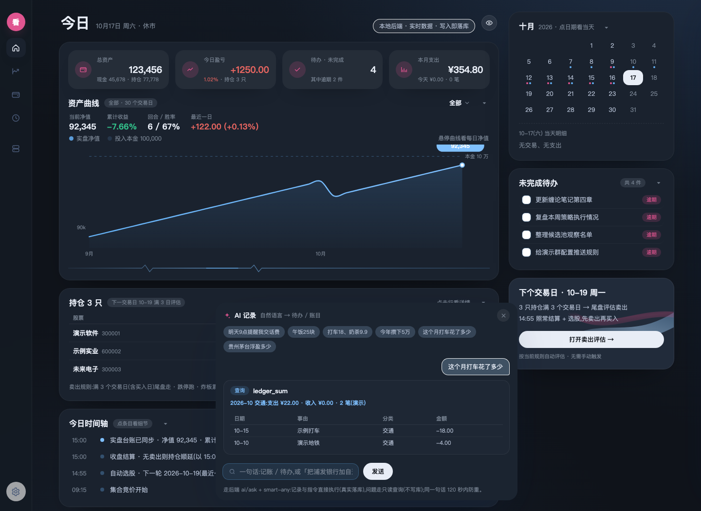
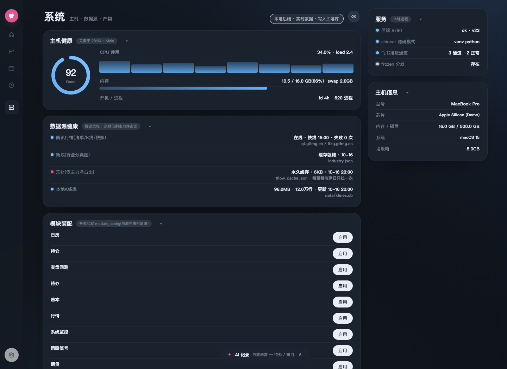
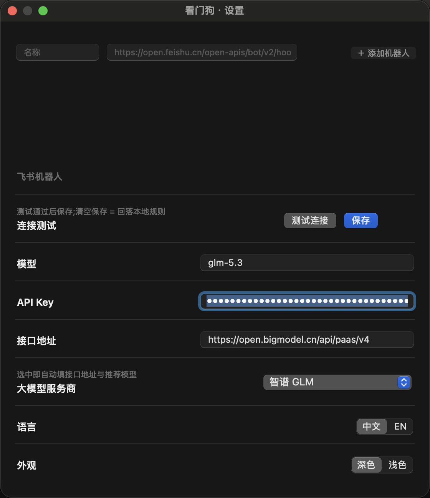

# 看门狗 Watchdog 🐕

**macOS 量化交易工作台** —— 涨停缩量策略全自动选股/结算 + 缠论信号监控 + 实盘台账 + 个人账本,一个 App 全包。

   

## 为什么做这个

市面上量化工具要么是纯回测脚本、要么是网页面板,没有一个是"**盘后自动跑完整流水线、开 App 就能看**"的桌面端。看门狗把一整套涨停缩量策略搬进了 macOS App:

- **14:55 自动结算**持仓(跌停跑 > 炸板3次走 > 涨停续命 > 满3交易日尾盘走)
- **14:55 自动选股**(六条件打分,候选来自近10日涨停滚动池+冷却簿,全流程约 1 分钟)
- **14:57 买入**评分前三、各 1/3 仓,买价锁定,持仓上限 3 只
- **飞书卡片**推送:卖出卡(带红绿盈亏)/ 持仓卡 / 买入卡 / 选股卡;盘中缠论买卖点一票一卡,事务性发件箱保证重试与幂等

## 界面预览

> 截图均为**合成演示数据**,仓库不含任何真实交易信息。

| 今日 · 深色 | 交易 · 深色 |
|---|---|
|  |  |

| 金钱 · 浅色 | 英文界面 · 浅色 |
|---|---|
|  |  |

| AI 记录 / 问答(自然语言) | 系统 · 主机与数据源健康 |
|---|---|
|  |  |

原生缠论图表(K线 + 笔 + 中枢 + 买卖点)由 AppKit 绘制,Web 表格点行直达:

| 偏好设置(主题 / 语言 / 大模型 / 飞书机器人) |
|---|
|  |

## 策略回测(2019–2026 八年)

> 涨停缩量二波策略:近10日涨停过 + MA20趋势 + 当日缩量15%~50% + 行业梯队≥3家 + 涨停日主力净占比≥15%,买入前三,断板/跌停/炸板规则化离场。

| 年份 | 2019 | 2020 | 2021 | 2022 | 2023 | 2024 | 2025 | 2026 |
|---|---|---|---|---|---|---|---|---|
| 收益 | +4% | +108% | +82% | +60% | +98% | +95% | +12% | +42% |

- 本金 10 万 · 3 成仓 → **383.6 万**(+3736%),1171 笔,胜率 50%,盈亏比 2.01
- **每年正收益,含 2022 熊市**;最差单笔对资产冲击仅 −8.4%
- 超额收益全部来自**出场规则**(截断左尾+放任右尾),同一入场换出场规则从 −48.7% 变 +190%

> ⚠️ 回测≠实盘:缩量小票容量有限(单票千万级),复利数字含理论成分。详见回测明细,独立可复现。

## 功能

| 模块 | 说明 |
|---|---|
| **今日总览** | 资产/盈亏/待办/月支出四卡 + 30 日资产曲线 + 持仓 + 当日时间轴,一屏看完 |
| **交易** | 持仓 / 自选行情(3s 快线)/ 期货监控表 / 最近一轮选股 / 候选池·冷却簿 / 飞书推送 |
| **金钱** | 账本 · 预算 · 月度趋势;自然语言记账,后端大模型解析直接落库 |
| **时间** | 待办 · 日志 / 复盘 |
| **系统** | 主机健康 / 数据源健康 / 模块装配 / 磁盘与产物 / 服务 |
| **AI 记录与问答** | 一句话:记账、待办、目标;也能下真实指令(加/移自选、切监控级别、跑选股、开关推送,真实落库)——问题走只读查询 |
| **缠论图表** | 原生 AppKit 绘制:K线+笔+中枢+B1/B2/B3·S1/S2/S3 买卖点,毫秒级开窗 |
| **策略引擎** | 14:55 自动结算 + 选股;六条件硬门槛 → 六因子排序;候选 = 涨停滚动集 − 持仓 − 冷却 |
| **飞书推送** | 事务性发件箱:重试 / 幂等 / 多机器人 / 多票池定向;App 内可视化卡面与逐目标投递 |
| **行情数据** | 腾讯优先(清单/K线/快照),新浪行业分类,东财仅剩主力净占比(每票每涨停日永久缓存);全 SQLite 本地 |

深色/浅色即时切换 · 中英双语 · 全卡片折叠(状态记忆) · 一键脱敏 · 单 App 全包(内置后端)。

## 快速开始

```bash
# 1. Release 下载 Watchdog_*.dmg,拖入 Applications 即用
#    (内置 PyInstaller 后端 + czsc 引擎,零依赖)

# 2. 源码运行
git clone https://github.com/Hong-Chen-web/watchdog.git
cd watchdog

# 后端(Python 3.11+;依赖 fastapi / uvicorn / requests / czsc 等)
cd server && python main.py            # http://127.0.0.1:8790

# 桌面壳(另开终端)
cd app/appkit
swift test                             # 全量回归(逻辑 / 离屏渲染 / 像素断言)
swift build -c release && ./bundle_app.sh
open dist/Watchdog.app
```

## 架构

```
Watchdog.app (AppKit 壳)
├─ 主窗口 WKWebView ── 本地 Web 工作台(server/static/,零构建零 CDN)
│    ↕ JS 桥(window.wd):原生 K 线窗 / 设置窗 / 主题·语言联动
├─ WatchdogCore        原生组件:K线绘图 / 设置 / 主题(旧原生仪表盘已归档 Legacy/,壳不再调用)
└─ watchdog-server     FastAPI + czsc(缠论)+ 腾讯/新浪行情源 + SQLite
     ├── routers/ui.py             Web 工作台快照 + AI 问答引擎
     ├── routers/chan·feishu.py    缠论信号/选股 与 飞书通道配置
     ├── selection.py              选股引擎(滚动池 + 六条件 + 六因子)
     ├── kline_store.py            K 线底库(SQLite,全 A 日 K)
     ├── feishu_push.py            事务性发件箱(重试/幂等/多机器人定向)
     └── chan_backtest_mirror.py   实盘台账镜像(资产曲线 / 持仓 / 盈亏)
```

## 隐私

- 所有个人数据(持仓 / 资产 / 账本 / 待办 / 自选 / 飞书 webhook)只存本机 SQLite,**永不进仓库**
- 仓库内的截图、测试夹具均为**合成演示数据**
- AI 功能需在「设置 → 大模型」自配 API Key,仅存本机

## 免责声明

本项目仅供学习与技术交流,不构成任何投资建议。股市有风险,入市需谨慎;据此交易,盈亏自负。

---

**Star ⭐ 支持一下,有问题/建议直接提 Issue。**
